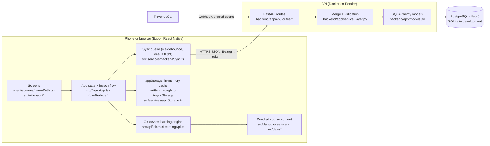
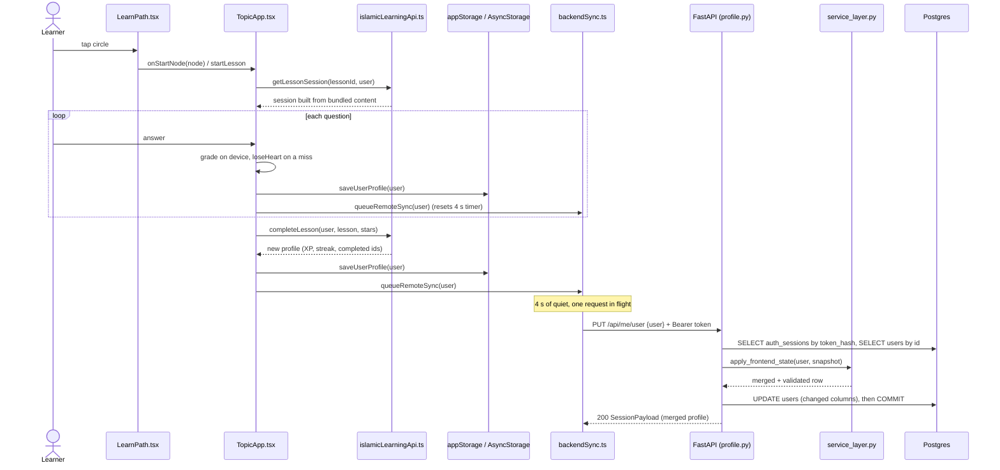
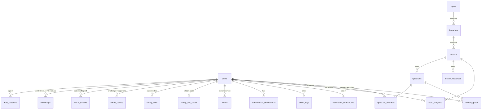

# Muslimo architecture: where the data goes

This is the end-to-end walkthrough: what happens when a learner taps a lesson, which code runs, what reaches the
server, which SQL runs, and how it's deployed and released. Every step names the file it lives in; if the code and
this page ever disagree, the code wins and this page needs fixing.

## The one idea to understand first: offline first

Muslimo is **offline first**. The lessons ship inside the app bundle, and the whole learning loop (path, questions,
hearts, XP, streak) runs on the phone with no server. The FastAPI backend does three jobs:

1. **Accounts and cloud backup.** The learner's progress follows them to a new phone.
2. **Social features** that need other people's data: Crew (friends), Family links, friend battles, invite codes and
   the Ummah ranking.
3. **Purchases.** The server learns from RevenueCat which learners paid.

So "the user taps a lesson" makes **no network call**. The network call happens a few seconds *after* the lesson
changes the profile, and it carries the whole profile, not a single event.

> The backend also has a normalized catalog (`topics` > `branches` > `lessons` > `questions`) and per-event
> learning routes (`POST /api/lessons/{slug}/completion`, `POST /api/questions/{id}/attempts`, `GET /api/review-queue`).
> They are implemented and tested but **the app doesn't call them yet**: `completeRemoteLesson` and
> `recordRemoteQuestionAttempt` in `src/services/backendSync.ts` have no callers. They are the planned path to
> server-delivered lessons (see [What I'd change next](#what-id-change-next)).

## Components



## Walkthrough: a learner taps a lesson

### 1. App start: load the learner (before any tap)

`App.tsx` calls `hydrateAppStorage()` (`src/services/appStorage.ts`), which reads every saved key from AsyncStorage
(device storage on Android/iOS, `localStorage` on the web) into an in-memory `Map`, so the rest of the app can read
storage synchronously. Then `TopicApp` mounts and its load effect (`src/TopicApp.tsx`, the `useEffect` with
`async function load()`):

1. `wakeBackend()` pings `GET /api/health` without waiting, because the free Render instance sleeps when idle.
2. `loadSavedUserProfile()` reads the profile saved on this phone.
3. `hydrateRemoteSession()` (`src/services/backendSync.ts`) sends `GET /api/session` with the saved bearer token,
   if there is one. A `401` signs the learner out; being offline keeps the saved session.
4. `pickStartingUser(remote, saved)` chooses: the phone's copy wins only if it has unsent changes
   (`hasPendingSync()`) for the same account; otherwise the server's copy wins.

On the server, `GET /api/session` (`backend/app/api/routes/auth.py`, `session`) goes through the `current_user`
dependency (`backend/app/api/deps.py` > `get_current_user_from_token` in `service_layer.py`):

```sql
SELECT * FROM auth_sessions WHERE token_hash = :sha256_of_bearer_token;   -- unique index
SELECT * FROM users WHERE id = :user_id;                                  -- primary key
SELECT * FROM subscription_entitlements WHERE user_id = :user_id;         -- lazy load in frontend_user_payload
```

The raw token is never stored: the server keeps only its SHA-256 (`hash_token` in `backend/app/core/security.py`),
so a leaked database can't be replayed as live sessions. An expired session is a `401`.

### 2. Tap a circle on the path

`LearnPath` (`src/ui/screens/LearnPath.tsx`) draws the path; each circle's state (`completed`, `current`,
`available`, `locked`) comes from `learningApi.getPathNodes(user)` (`src/api/islamicLearningApi.ts`), computed from
`user.completedNodeIds` and whether the learner has premium. Tapping calls `onStartNode` > `startLesson(node)` in
`src/TopicApp.tsx`, which:

1. Refuses a premium unit for a free learner (opens the shop), a locked circle, or a learner with no hearts.
2. Calls `learningApi.getLessonSession(lessonId, user, ageGroup)`. Despite the name this is **not** a network call:
   it looks the lesson up in `LESSONS_BY_ID` (built in `src/data/course.ts`), picks questions for the learner's age
   and difficulty (`lessonForAge`, `lessonAtLevel`, `challengeLevel`), and appends a few previously missed questions
   that are due again (`withMissedQuestions`, the on-device spaced review).
3. Dispatches `start_lesson`; the lesson screens in `src/ui/lesson/` render from that session.

### 3. Answer questions

`answerChallenge()` in `src/TopicApp.tsx` grades on the device (`challenge.correctChoiceId ===
state.selectedChoiceId`). A wrong answer calls `loseHeart` (`src/api/islamicLearningApi.ts`); the first try's result
updates the learner profile (`applyLessonSignalToLearnerProfile`) and the Review deck (`recordLessonAnswer`). Each of
these produces a **new immutable `UserProfile` object** dispatched into the reducer.

### 4. Finish the lesson

`continueLesson()` in `src/TopicApp.tsx` calls `completeLesson(user, lesson, stars)`
(`src/api/islamicLearningApi.ts`), which returns a new profile with:

- the lesson and circle added to `completedLessonIds` / `completedNodeIds`, and the circle's best stars in `nodeStars`;
- XP from `getLessonXp` added by `addXp`: `totalXp`, `dailyXp` (today, on the phone's clock), `xpByDay`, and the
  weekly league XP. A replay of a finished lesson pays no XP;
- the streak advanced by `keepStreak` (once per local day; streak freezes cover missed days).

### 5. Save locally, then queue a sync

Every change to `state.user` runs one effect in `src/TopicApp.tsx`:

```ts
saveUserProfile(state.user);   // src/services/localProgress.ts > appStorage > AsyncStorage
queueRemoteSync(state.user);   // src/services/backendSync.ts
```

`queueRemoteSync` only does something for a signed-in account. It marks `sira-path-pending-sync` first (so an app
killed mid-send still knows the server is behind), then waits **4 seconds of quiet** (`SYNC_QUIET_MS`) before
sending, and never has two sends in flight: a lesson changes the profile on every answer, and sending each copy
flooded the server and let replies arrive out of order. Failed sends are retried every minute, when the app returns
to the foreground, and when the phone comes back online; going to the background flushes immediately.

### 6. The request

```http
PUT /api/me/user
Authorization: Bearer <session token>
Content-Type: application/json

{"user": { "totalXp": 1240, "streakDays": 6, "lastStreakDate": "2026-11-10",
           "completedLessonIds": [...], "completedNodeIds": [...], "nodeStars": {...},
           "hearts": {"current": 4, "max": 5, "lastRefillDate": "2026-11-10"},
           "xpByDay": {...}, "league": {...}, "reviewCards": [...], ... }}
```

`PUT /api/me/user` and `PUT /api/profile/me` are the same handler (`backend/app/api/routes/profile.py`,
`update_profile`). FastAPI validates the envelope with `ProfileUpdateInput` (`backend/app/schemas.py`); the
`user` object is deliberately a free-form dict, because the app adds profile fields faster than the server
changes.

### 7. The merge (`apply_frontend_state`, `backend/app/service_layer.py`)

The server never just overwrites, because two phones, or one that was offline for days, can send copies that are
out of step. The rules:

| Data | Rule | Why |
| --- | --- | --- |
| `completedLessonIds`, `completedNodeIds`, `claimedRewardIds` | union (`union_ids`) | an offline phone can't un-finish a lesson |
| `nodeStars` | per circle, the higher | stars only go up |
| `totalXp` | the higher, capped at server total + 5,000 per day since the last save (`max_total_xp`) | stops a hand-made request from posting millions of XP to rankings |
| `xpByDay`, `dailyXp` | per day, the higher, each capped at 5,000; last 28 days kept | the weekly race and family chart |
| streak, `league` | an older date or week never replaces a newer one | |
| quiz scores, Ramadan days, stories | merged (best score, union, latest read) in `clean_extra_state` | |
| `gems`, `hearts`, settings | the latest copy wins | they are spent, so "higher wins" would be wrong |
| `hearts.unlimited` | **never** taken from the app | only a store-confirmed plan grants it |
| unknown fields | kept in `progress_extra_json` (max 40 keys, 256 KB) | a new app build needs no migration |

Every value that goes into a typed column is checked first (`clean_int`, `clean_bool`, `clean_text`, `clean_dict`):
a string in an INTEGER column, a number past 2,147,483,647, or text longer than `String(n)` keeps the saved value.
SQLite accepts those values silently, but Postgres would reject the whole save.

### 8. The SQL

```sql
-- current_user dependency, as in step 1
SELECT * FROM auth_sessions WHERE token_hash = :h;
SELECT * FROM users WHERE id = :id;
-- frontend_user_payload / get_active_entitlement
SELECT * FROM subscription_entitlements WHERE user_id = :id;
-- db.commit(): one UPDATE of the changed columns, JSON columns serialized whole
UPDATE users SET total_xp = :xp, streak_days = :s, last_streak_date = :d,
                 completed_lesson_ids_json = :json, node_stars_json = :json, xp_history_json = :json,
                 progress_extra_json = :json, ..., updated_at = :now
 WHERE users.id = :id;
-- db.refresh(user)
SELECT * FROM users WHERE id = :id;
```

The handler returns the merged profile (`SessionPayload`), so the phone ends up with the server's view.

### 9. Where the social screens read it

Other learners see this learner only through routes that read the same `users` row, and only after **both sides**
added each other (`backend/app/api/routes/friends.py`; the app is used by children, so one-sided adds reveal
nothing). For example `GET /api/friends?today=2026-11-10`:

```sql
SELECT * FROM friendships WHERE user_id = :me ORDER BY created_at;          -- who I added
SELECT user_id FROM friendships WHERE friend_id = :me;                      -- who added me
SELECT * FROM friendships WHERE friend_id = :me ORDER BY created_at;        -- requests
SELECT * FROM users WHERE id = :friend_id;                                   -- per friend (lazy load)
SELECT * FROM friend_streaks WHERE user_low_id = :low AND user_high_id = :high;  -- per friend
SELECT * FROM friendships WHERE user_id = :friend_id AND friend_id = :me;    -- per friend (friends_since)
```

Weekly XP and live streaks are computed in Python from `xp_history_json` on the **caller's** local date (the
`today` query parameter), so a learner in Dhaka and one in Philadelphia see the same week boundaries as their own
phones.

### The same flow as a sequence



## Other flows in one line each

| Flow | Route (file) | Tables |
| --- | --- | --- |
| Sign up | `POST /api/auth/register` (`routes/auth.py`) | INSERT `users` (PBKDF2 hash), INSERT `auth_sessions` |
| Log in | `POST /api/auth/login`, rate limited 10 per email per 15 min | SELECT `users` by email, DELETE expired + INSERT `auth_sessions` |
| Google / Apple | `POST /api/auth/social`; ID token verified against the provider's JWKS (`core/social_tokens.py`) | `users`, `auth_sessions` |
| Delete account | `DELETE /api/profile/me` (`routes/profile.py`) | DELETE `users` (ORM cascades), `family_links`, `newsletter_subscribers` (`forget_newsletter`, which also removes the Brevo contact) |
| Family link | `POST /api/family/code` on the child's phone, `POST /api/family/kids` on the parent's | `family_link_codes` (6 chars, 24 h, one use), `family_links` |
| Friend battle | `POST /api/battles`, `/accept`, `/score` (`routes/battles.py`) | `friend_battles` (both play the same `seed`; scores hidden until both played) |
| Invite code | `POST /api/invites/redeem`, `/claim` (`routes/invites.py`) | `invites` (code = base-31 user id + check letter) |
| Ummah ranking | `POST /api/ummah/rankings` (`routes/ummah.py`) | `users.ummah_ranked` / `ummah_trophies` (copied from `ummah_json`), `ORDER BY ... LIMIT 50` + `COUNT(*)` on `ix_users_ummah_ranking` |
| Purchase | RevenueCat > `POST /api/subscriptions/revenuecat/webhook` (shared secret, `hmac.compare_digest`) | `subscription_entitlements`, `event_logs` |
| Owner stats | `GET /api/admin/stats` with `X-Admin-Key` (`routes/admin.py`) | aggregate reads of `users`, `subscription_entitlements`, `invites` |
| Newsletter | `POST /api/newsletter/subscribe` (website; 3 per email per hour, confirmed from an emailed link via `/confirm`), `PUT /api/newsletter/me` (the app's Settings tick box; Kid accounts refused), `/api/admin/newsletter*` with `X-Admin-Key` (`routes/newsletter.py`, `core/brevo.py`) | `newsletter_subscribers` (token stored as a hash, like sessions) |

## Data model

Source of truth: `backend/app/models.py` (SQLAlchemy 2.0 declarative). There are 19 tables in four groups.



1. **Accounts and synced progress:** `users` (one wide row per learner, with JSON columns for list- and map-shaped
   progress), `auth_sessions`, `subscription_entitlements`, `event_logs`.
2. **Social:** `friendships` (directed: a pair is mutual when both rows exist), `friend_streaks` (one row per pair,
   `user_low_id < user_high_id`), `friend_battles`, `family_links`, `family_link_codes`, `invites`.
3. **Catalog and normalized learning (not used by the app yet):** `topics`, `branches`, `lessons`, `questions`,
   `lesson_resources`, `user_progress`, `question_attempts`, `review_queue`.
4. **Newsletter:** `newsletter_subscribers` (one row per email; `user_id` is set when the learner joined from the
   app, and website sign-ups have none).

### Why one wide `users` row with JSON columns?

The app's unit of state is one `UserProfile` object (`src/types.ts`) that changes on every answer and is synced
whole. Storing it as columns plus JSON means one indexed read and one UPDATE per sync, and new app fields land in
`progress_extra_json` without a migration. The cost: JSON columns can't be indexed or joined portably, so anything
that has to be queried across learners gets a real column. The Ummah ranking is the example: `User` copies
trophies and "joined with a nickname" out of `ummah_json` into `ummah_trophies` / `ummah_ranked` on every assignment
(a SQLAlchemy `@validates` hook in `models.py`), and migration `20261119_0013` backfilled them and added the index.
Columns are also used where the server must enforce rules (`total_xp`, `streak_days`, `hearts_*`, `gems`) or where
other routes read them.

### Schema (PostgreSQL, as `create_all` builds it on a fresh database)

Migration `20260412_0001` builds the tables from the current models, and the later migrations only add what an
older database is missing, so a fresh database matches the DDL below. "App default" means a Python-side default
SQLAlchemy fills in on INSERT; only `DEFAULT` clauses are in the database itself.

```sql
CREATE TABLE users (
  id                         SERIAL PRIMARY KEY,
  email                      VARCHAR(255) NOT NULL,          -- unique index ix_users_email
  username                   VARCHAR(80)  NOT NULL,          -- unique index ix_users_username (ali, ali2, ...)
  display_name               VARCHAR(120) NOT NULL,
  password_hash              VARCHAR(255),                   -- passlib pbkdf2_sha256; NULL for Google/Apple
  auth_provider              VARCHAR(40)  NOT NULL,          -- app default 'password'
  provider_subject           VARCHAR(255),                   -- Google/Apple "sub"
  account_role               VARCHAR(40),                    -- 'child' | 'parent'
  preferred_language         VARCHAR(16)  NOT NULL,          -- app default 'en'
  sound_enabled              BOOLEAN      NOT NULL,
  reduced_sound              BOOLEAN      NOT NULL,
  skipped_foundation         BOOLEAN      NOT NULL,
  premium_status             VARCHAR(40)  NOT NULL,          -- 'free' or a plan id
  review_heart_restore_used  BOOLEAN      NOT NULL,
  streak_days                INTEGER      NOT NULL,
  last_streak_date           VARCHAR(10),                    -- the device's local YYYY-MM-DD
  daily_xp_date              VARCHAR(10),
  daily_xp                   INTEGER      NOT NULL DEFAULT 0,
  xp_history_json            JSON         NOT NULL,          -- {"2026-11-10": 40, ...}, last 28 days
  total_xp                   INTEGER      NOT NULL,
  daily_goal_xp              INTEGER      NOT NULL,          -- app default 40
  gems                       INTEGER      NOT NULL,          -- app default 120 ("dates" in the UI)
  hearts_current             INTEGER      NOT NULL,          -- app default 5
  hearts_max                 INTEGER      NOT NULL,          -- app default 5
  hearts_unlimited           BOOLEAN      NOT NULL,          -- set only by the RevenueCat webhook path
  last_heart_refill_at       TIMESTAMPTZ,
  last_login_at              TIMESTAMPTZ,
  last_learning_at           TIMESTAMPTZ,
  reminder_preferences_json  JSON NOT NULL,
  learner_profile_json       JSON NOT NULL,
  completed_lesson_ids_json  JSON NOT NULL,                  -- ["lesson-id", ...]
  completed_node_ids_json    JSON NOT NULL,
  claimed_reward_ids_json    JSON NOT NULL,
  node_stars_json            JSON NOT NULL,                  -- {"node-id": 1..3}
  last_topic_id              VARCHAR(40),
  path_focus_json            JSON NOT NULL,
  league_json                JSON NOT NULL,                  -- {tier, weekStart, xp, last}
  ummah_json                 JSON NOT NULL,                  -- {trophies, best, nickname, joined, ...}
  ummah_trophies             INTEGER NOT NULL DEFAULT 0,     -- copy of ummah_json.trophies
  ummah_ranked               BOOLEAN NOT NULL DEFAULT false, -- joined with a nickname
  social_hub_json            JSON NOT NULL,
  progress_extra_json        JSON NOT NULL,                  -- every other profile field, <= 40 keys / 256 KB
  created_at                 TIMESTAMPTZ NOT NULL DEFAULT now(),
  updated_at                 TIMESTAMPTZ NOT NULL DEFAULT now()
);
CREATE INDEX ix_users_ummah_ranking ON users (ummah_ranked, ummah_trophies DESC, id);

CREATE TABLE auth_sessions (
  id          SERIAL PRIMARY KEY,
  user_id     INTEGER NOT NULL REFERENCES users(id) ON DELETE CASCADE,   -- index
  token_hash  VARCHAR(64) NOT NULL,                                     -- unique index; sha256 hex of the token
  expires_at  TIMESTAMPTZ NOT NULL,                                     -- now + SIRA_SESSION_TTL_HOURS (720)
  created_at  TIMESTAMPTZ NOT NULL DEFAULT now()
);

CREATE TABLE friendships (
  id          SERIAL PRIMARY KEY,
  user_id     INTEGER NOT NULL REFERENCES users(id) ON DELETE CASCADE,   -- index
  friend_id   INTEGER NOT NULL REFERENCES users(id) ON DELETE CASCADE,   -- index
  relation    VARCHAR(20) NOT NULL DEFAULT 'friend',                     -- 'friend' | 'parent'
  created_at  TIMESTAMPTZ NOT NULL DEFAULT now(),
  CONSTRAINT uq_friendship_pair UNIQUE (user_id, friend_id)
);

CREATE TABLE friend_streaks (
  id            SERIAL PRIMARY KEY,
  user_low_id   INTEGER NOT NULL REFERENCES users(id) ON DELETE CASCADE,  -- index
  user_high_id  INTEGER NOT NULL REFERENCES users(id) ON DELETE CASCADE,  -- index
  days          INTEGER NOT NULL DEFAULT 0,
  last_day      VARCHAR(10),
  best_days     INTEGER NOT NULL DEFAULT 0,
  CONSTRAINT uq_friend_streak_pair UNIQUE (user_low_id, user_high_id)
);

CREATE TABLE friend_battles (
  id                SERIAL PRIMARY KEY,
  challenger_id     INTEGER NOT NULL REFERENCES users(id) ON DELETE CASCADE,  -- index
  opponent_id       INTEGER NOT NULL REFERENCES users(id) ON DELETE CASCADE,  -- index
  status            VARCHAR(20) NOT NULL DEFAULT 'pending',   -- pending | accepted | declined | done
  seed              INTEGER NOT NULL,                         -- both phones pick the same questions from it
  challenger_score  INTEGER,
  opponent_score    INTEGER,
  created_at        TIMESTAMPTZ NOT NULL DEFAULT now(),
  updated_at        TIMESTAMPTZ NOT NULL DEFAULT now()
);

CREATE TABLE family_links (
  id          SERIAL PRIMARY KEY,
  parent_id   INTEGER NOT NULL REFERENCES users(id) ON DELETE CASCADE,  -- index
  child_id    INTEGER NOT NULL REFERENCES users(id) ON DELETE CASCADE,  -- index
  created_at  TIMESTAMPTZ NOT NULL DEFAULT now(),
  CONSTRAINT uq_family_link_pair UNIQUE (parent_id, child_id)
);

CREATE TABLE family_link_codes (
  code        VARCHAR(12) PRIMARY KEY,                                  -- 6 chars, no look-alike letters
  child_id    INTEGER NOT NULL REFERENCES users(id) ON DELETE CASCADE,  -- unique index: one code per child
  expires_at  TIMESTAMPTZ NOT NULL                                      -- 24 hours
);

CREATE TABLE invites (
  id                SERIAL PRIMARY KEY,
  inviter_id        INTEGER NOT NULL REFERENCES users(id) ON DELETE CASCADE,          -- index
  invitee_id        INTEGER NOT NULL UNIQUE REFERENCES users(id) ON DELETE CASCADE,   -- one code per learner, ever
  inviter_rewarded  BOOLEAN NOT NULL DEFAULT false,
  created_at        TIMESTAMPTZ NOT NULL DEFAULT now()
);

CREATE TABLE subscription_entitlements (
  id                    SERIAL PRIMARY KEY,
  user_id               INTEGER NOT NULL REFERENCES users(id) ON DELETE CASCADE,  -- index
  provider              VARCHAR(80)  NOT NULL,         -- 'revenuecat' (or a dev-only client sync)
  provider_customer_id  VARCHAR(255),
  plan_type             VARCHAR(80)  NOT NULL,         -- free | no_ads_monthly | no_ads_yearly | premium_monthly | premium_yearly
  status                VARCHAR(40)  NOT NULL,         -- active | trialing | cancelled | billing_issue | expired
  started_at            TIMESTAMPTZ,
  expires_at            TIMESTAMPTZ,
  entitlement_name      VARCHAR(120) NOT NULL,         -- 'premium' | 'no_ads'
  created_at            TIMESTAMPTZ NOT NULL DEFAULT now(),
  updated_at            TIMESTAMPTZ NOT NULL DEFAULT now()
);

CREATE TABLE event_logs (
  id            SERIAL PRIMARY KEY,
  user_id       INTEGER REFERENCES users(id) ON DELETE SET NULL,   -- index
  event_type    VARCHAR(120) NOT NULL,                             -- index
  payload_json  JSON NOT NULL,                                     -- <= 16 KB from /api/analytics/events
  created_at    TIMESTAMPTZ NOT NULL DEFAULT now()
);

CREATE TABLE newsletter_subscribers (
  id               SERIAL PRIMARY KEY,
  email            VARCHAR(255) NOT NULL,                             -- unique index
  status           VARCHAR(20)  NOT NULL,                             -- index; app default 'pending', then 'subscribed' / 'unsubscribed'
  source           VARCHAR(20)  NOT NULL,                             -- 'website' | 'app'
  language         VARCHAR(16)  NOT NULL,                             -- app default 'en'
  user_id          INTEGER REFERENCES users(id) ON DELETE CASCADE,    -- index; NULL for website sign-ups
  token_hash       VARCHAR(128) NOT NULL,                             -- unique index; SHA-256 of the confirm/unsubscribe link secret
  confirm_sent_at  TIMESTAMPTZ,
  confirmed_at     TIMESTAMPTZ,
  unsubscribed_at  TIMESTAMPTZ,
  created_at       TIMESTAMPTZ NOT NULL DEFAULT now(),
  updated_at       TIMESTAMPTZ NOT NULL DEFAULT now()
);

-- Catalog, seeded by backend/app/catalog_seed.py on every deploy (13 topics, 85 branches, 1,261 lessons, 2,009 questions)
CREATE TABLE topics (
  id SERIAL PRIMARY KEY, title VARCHAR(120) NOT NULL, slug VARCHAR(120) NOT NULL,   -- unique index on slug
  description TEXT NOT NULL, icon VARCHAR(80) NOT NULL, color_theme VARCHAR(80) NOT NULL, order_index INTEGER NOT NULL,
  created_at TIMESTAMPTZ NOT NULL DEFAULT now(), updated_at TIMESTAMPTZ NOT NULL DEFAULT now()
);
CREATE TABLE branches (
  id SERIAL PRIMARY KEY, topic_id INTEGER NOT NULL REFERENCES topics(id) ON DELETE CASCADE,  -- index
  title VARCHAR(160) NOT NULL, slug VARCHAR(160) NOT NULL,                                     -- index
  description TEXT NOT NULL, order_index INTEGER NOT NULL, difficulty_start INTEGER NOT NULL, difficulty_end INTEGER NOT NULL,
  source_references_json JSON NOT NULL,
  created_at TIMESTAMPTZ NOT NULL DEFAULT now(), updated_at TIMESTAMPTZ NOT NULL DEFAULT now(),
  CONSTRAINT uq_branch_topic_slug UNIQUE (topic_id, slug)
);
CREATE TABLE lessons (
  id SERIAL PRIMARY KEY, branch_id INTEGER NOT NULL REFERENCES branches(id) ON DELETE CASCADE,  -- index
  title VARCHAR(180) NOT NULL, slug VARCHAR(180) NOT NULL,                                       -- index
  description TEXT NOT NULL, order_index INTEGER NOT NULL, difficulty INTEGER NOT NULL, is_premium BOOLEAN NOT NULL,
  xp_reward INTEGER NOT NULL, lesson_type VARCHAR(80) NOT NULL, content_body TEXT NOT NULL, unlock_rule TEXT,
  estimated_minutes INTEGER NOT NULL, surah_name VARCHAR(160), ayah_range VARCHAR(80), mastery_test_eligible BOOLEAN NOT NULL,
  created_at TIMESTAMPTZ NOT NULL DEFAULT now(), updated_at TIMESTAMPTZ NOT NULL DEFAULT now(),
  CONSTRAINT uq_lesson_branch_slug UNIQUE (branch_id, slug)
);
CREATE TABLE questions (
  id SERIAL PRIMARY KEY, lesson_id INTEGER NOT NULL REFERENCES lessons(id) ON DELETE CASCADE,  -- index
  type VARCHAR(80) NOT NULL, prompt TEXT NOT NULL, options_json JSON NOT NULL, correct_answer_json JSON NOT NULL,
  explanation_short TEXT NOT NULL, explanation_long TEXT NOT NULL, tags_json JSON NOT NULL,
  difficulty INTEGER NOT NULL, order_index INTEGER NOT NULL,
  created_at TIMESTAMPTZ NOT NULL DEFAULT now(), updated_at TIMESTAMPTZ NOT NULL DEFAULT now()
);
CREATE TABLE lesson_resources (
  id SERIAL PRIMARY KEY, lesson_id INTEGER NOT NULL REFERENCES lessons(id) ON DELETE CASCADE,  -- index
  title VARCHAR(180) NOT NULL, url TEXT NOT NULL, source_type VARCHAR(80) NOT NULL, speaker VARCHAR(160),
  notes TEXT NOT NULL, review_status VARCHAR(80) NOT NULL, is_sunni_approved BOOLEAN NOT NULL,
  created_at TIMESTAMPTZ NOT NULL DEFAULT now(), updated_at TIMESTAMPTZ NOT NULL DEFAULT now()
);

-- Normalized learning events (routes exist and are tested; the app doesn't call them yet)
CREATE TABLE user_progress (
  id SERIAL PRIMARY KEY,
  user_id   INTEGER NOT NULL REFERENCES users(id) ON DELETE CASCADE,          -- index
  topic_id  INTEGER REFERENCES topics(id) ON DELETE SET NULL,                 -- index
  branch_id INTEGER REFERENCES branches(id) ON DELETE SET NULL,               -- index
  lesson_id INTEGER NOT NULL REFERENCES lessons(id) ON DELETE CASCADE,        -- index
  status VARCHAR(40) NOT NULL, mastery_score INTEGER NOT NULL, xp_earned INTEGER NOT NULL, best_score INTEGER NOT NULL,
  last_seen_at TIMESTAMPTZ, completed_at TIMESTAMPTZ,
  created_at TIMESTAMPTZ NOT NULL DEFAULT now(), updated_at TIMESTAMPTZ NOT NULL DEFAULT now(),
  CONSTRAINT uq_user_progress_lesson UNIQUE (user_id, lesson_id)
);
CREATE TABLE question_attempts (
  id SERIAL PRIMARY KEY,
  user_id     INTEGER NOT NULL REFERENCES users(id) ON DELETE CASCADE,       -- index
  question_id INTEGER NOT NULL REFERENCES questions(id) ON DELETE CASCADE,   -- index
  lesson_id   INTEGER NOT NULL REFERENCES lessons(id) ON DELETE CASCADE,     -- index
  selected_answer_json JSON NOT NULL, is_correct BOOLEAN NOT NULL,
  response_time_ms INTEGER, confidence_rating INTEGER,
  created_at TIMESTAMPTZ NOT NULL DEFAULT now()
);
CREATE TABLE review_queue (
  id SERIAL PRIMARY KEY,
  user_id     INTEGER NOT NULL REFERENCES users(id) ON DELETE CASCADE,       -- index
  topic_id    INTEGER REFERENCES topics(id) ON DELETE SET NULL,              -- index
  branch_id   INTEGER REFERENCES branches(id) ON DELETE SET NULL,            -- index
  lesson_id   INTEGER REFERENCES lessons(id) ON DELETE SET NULL,             -- index
  question_id INTEGER NOT NULL REFERENCES questions(id) ON DELETE CASCADE,   -- index
  priority INTEGER NOT NULL, failure_count INTEGER NOT NULL,
  next_review_at TIMESTAMPTZ, last_reviewed_at TIMESTAMPTZ,
  created_at TIMESTAMPTZ NOT NULL DEFAULT now(), updated_at TIMESTAMPTZ NOT NULL DEFAULT now(),
  CONSTRAINT uq_review_queue_question UNIQUE (user_id, question_id)
);
```

### Queries worth knowing by heart

```sql
-- Topic list with counts (GET /api/topics, routes/catalog.py): two GROUP BYs instead of 2 queries per topic.
SELECT branches.topic_id, count(branches.id) FROM branches GROUP BY branches.topic_id;
SELECT branches.topic_id, count(lessons.id)
  FROM branches JOIN lessons ON lessons.branch_id = branches.id
 GROUP BY branches.topic_id;

-- Review queue, most urgent first (GET /api/review-queue, routes/learning.py)
SELECT * FROM review_queue WHERE user_id = :me ORDER BY priority DESC, next_review_at ASC;

-- Is this pair mutual? (are_friends in routes/battles.py)
SELECT * FROM friendships WHERE user_id = :me AND friend_id = :other;
SELECT * FROM friendships WHERE user_id = :other AND friend_id = :me;
```

## Security model, briefly

| Concern | How it's handled | Where |
| --- | --- | --- |
| Passwords | PBKDF2-SHA256 (passlib), min 8 chars | `core/security.py`, `schemas.AuthRegisterInput` |
| Sessions | 48 random bytes (`secrets.token_urlsafe`), stored as SHA-256, 30-day expiry, expired rows deleted at next login | `core/security.py`, `routes/auth.py` |
| Guessing | 10 logins per email / 15 min; 10 family or invite codes per account / 15 min; 30 friend adds per hour; 3 newsletter sign-ups per email per hour | `core/rate_limit.py` (in memory, one process) |
| Social login | RS256 only, `aud`, `iss`, `exp` and verified email checked against Google/Apple JWKS | `core/social_tokens.py` |
| Takeover of an unverified email sign-up | a later verified Google/Apple sign-in for that email clears the password and signs out every session | `routes/auth.py`, `social_login` |
| Premium | only the RevenueCat webhook (shared secret, constant-time compare) grants it in production; a product missing from `STORE_PRODUCT_PLANS` grants nothing and is logged | `routes/subscriptions.py`, `core/subscriptions.py` |
| Children's privacy | nothing is shared until both sides add each other; the ranking shows a generated nickname only | `routes/friends.py`, `service_layer.clean_ummah` |
| SQL injection | every query is built with SQLAlchemy expressions and bound parameters; no string-built SQL | `backend/app/**` |
| Oversized requests | bodies over `SIRA_MAX_REQUEST_BODY_BYTES` (1 MiB) get 413 before any route parses them; stored JSON has per-field caps (`progress_extra_json` 256 KB, `socialHub` 64 KB, analytics 16 KB) | `core/body_limit.py`, `schemas.py`, `service_layer.py` |
| CORS | explicit allow-list (`SIRA_CORS_ORIGINS_RAW` + the GitHub Pages stats page); the phone apps don't use CORS | `main.py` |

## Deployment and release

This section describes what the repository sets up. Some things live outside it: whether the Render service is
running right now, which EAS environment variables are set, and where a store submission stands today. Those are in
the Render, EAS and App Store Connect / Play Console dashboards, so check there before quoting them.

### What runs where

| Piece | Setup | Defined in |
| --- | --- | --- |
| API | One Render web service, `muslimo-api`, `runtime: docker`, built from `backend/Dockerfile` with the repository root as context. **Free plan**: it sleeps after 15 idle minutes and takes up to a minute to wake. Health check `GET /api/health`; `autoDeploy: true` redeploys on every push | `render.yaml` |
| Settings and secrets | `SIRA_ENVIRONMENT=production` is set by the blueprint and by the image. `SIRA_DATABASE_URL`, `SIRA_REVENUECAT_WEBHOOK_AUTH`, `SIRA_GOOGLE_CLIENT_IDS_RAW`, `SIRA_ADMIN_KEY`, `SIRA_BREVO_API_KEY` and `SIRA_BREVO_LIST_ID` are `sync: false`: typed into the Render dashboard, never stored in git | `render.yaml`, `backend/Dockerfile`, `backend/app/core/config.py` |
| Database | **Not part of the blueprint.** A free Neon Postgres project (0.5 GB) in AWS US East, next to Render's Virginia region, connected through `SIRA_DATABASE_URL`. Render's own free Postgres is deleted after 30 days, so it isn't used. `config.py` rewrites `postgres://` / `postgresql://` to `postgresql+psycopg://` | `render.yaml` (top comment), `docs/hosting.md`, `backend/app/core/config.py` |
| Container start | `python:3.12-slim`, runs as the non-root user `sira`. Every start runs `backend/scripts/bootstrap.py` (`alembic upgrade head`, then the idempotent catalog seed), then Uvicorn on `$PORT` with `--proxy-headers` | `backend/Dockerfile`, `backend/scripts/bootstrap.py` |
| App builds | Expo EAS, project `ae9b976c-...` owned by `fahadbin.alam`. `eas.json` profiles: **development** (dev client, internal distribution, sandbox purchases), **preview** (internal distribution, Android APK, sandbox purchases), **production** (Android App Bundle, build number auto-incremented, version source remote). `requireCommit: true`; Node 22.22.0 | `eas.json`, `app.json` |
| API address in the app | `EXPO_PUBLIC_API_BASE_URL`, set per EAS environment with `eas env:create` (it isn't in `eas.json`). A release build without it is offline-only and never calls `localhost` | `src/config/backend.ts`, `docs/hosting.md` (step 4) |
| Store upload | `eas submit` (production profile): Android goes to the Play **internal** track as a **draft**, using a service-account key in `secrets/` (git-ignored). There's no iOS `submit` block, so `eas submit --platform ios` uses EAS's defaults | `eas.json`, `.gitignore`, `docs/release.md` |
| Website | `site/` is published to GitHub Pages by `.github/workflows/pages.yml` on pushes to `main` that touch it (skipped until `site/site.config.json` is filled in). The log-in page, the newsletter page and the owner's stats page call `https://muslimo-api.onrender.com` | `.github/workflows/pages.yml`, `site/log-in.html`, `site/newsletter.html`, `site/stats.html` |

### What CI checks, and what it doesn't

`.github/workflows/ci.yml` runs on every push to `main` and on every pull request, in three jobs:

| Job | What it runs |
| --- | --- |
| `app` | Node 22, `npm ci`, `npm run typecheck` (`tsc --noEmit`), `npm test -- --ci` (Jest, 178 test files), `node --test scripts/obsidian-import/lib.test.mjs`, `expo export` for Android and iOS, then `scripts/check-release-config.mjs` (version format, bundle ids, iOS export-compliance flag, privacy manifest, blocked Android permissions) |
| `web-smoke` | `expo export --platform web`, then `scripts/smoke-web.mjs` opens the build in headless Chromium (Playwright) and fails if the first screen doesn't render |
| `backend` | Python 3.12, `pip install -r backend/requirements-dev.txt`, `python -m pytest backend/tests -q` (FastAPI `TestClient` on a throwaway SQLite file, `backend/tests/conftest.py`) |

Not covered: tests against Postgres (they use SQLite), Alembic migrations against a real database, building the
Docker image, a Python linter, and an EAS build. CI and deploys are separate: `render.yaml` only says
`autoDeploy: true`, and Render's option to deploy only after CI checks pass is a service setting, so confirm it in
the Render dashboard.

### Release status (what the repository shows)

| | Status | Evidence |
| --- | --- | --- |
| Version | `1.0.0`; bundle id and package `com.islamiclearning.muslimo` | `app.json`, `scripts/check-release-config.mjs` |
| App Store (iOS) | Version 1.0.0 went to App Review and was rejected for two reasons, both fixed on `main` (PR #690): guideline 4 (use Apple's own Sign in with Apple button) and guideline 5.1.2(i) (don't show Google's personalised-ads consent form on iPhone). The website now says the iPhone app "is in final review with the App Store" (`site/index.html`, PR #718); `site/app-version.json` still has `"ios": { "build": 0 }`, which `docs/release.md` says stays 0 until the iPhone app is on the App Store | `src/ui/screens/AppleSignInButton.native.tsx`, `src/__tests__/appleSignInButton.test.tsx`, `src/services/monetization.native.ts`, `site/index.html`, `site/app-version.json`, `docs/release.md` |
| Google Play | Out on Google Play: `site/index.html` says "Muslimo is out now on Google Play" and links the store page (PR #718), and `site/app-version.json` sets Android to build 18, which `docs/release.md` says goes up only once a build is live in the store | `site/index.html`, `site/app-version.json`, `eas.json`, `docs/release.md` |
| Still open in the store checklist | "Production API served over HTTPS: Needed before release" | `store/README.md` |
| Users | The repository has no user numbers (the owner's stats page reads them live), so don't quote any | `site/stats.html` |

### What's still weak in the setup

1. **The free plan sleeps** (`render.yaml`). The first request after 15 idle minutes can wait up to a minute. The
   app copes (offline first, a wake-up ping, 30 s / 60 s timeouts in `src/config/backend.ts`), but it's a poor first
   impression. The fix is the Starter plan (about $7 a month).
2. **No backups, error tracking or uptime alerts are set up in the repository.** Neon's point-in-time restore depends
   on the plan, and nothing like Sentry appears in `package.json` or `backend/requirements.txt`.
3. **One process.** The rate limiter keeps counts in memory (`backend/app/core/rate_limit.py`), which is right only
   while the Dockerfile runs one Uvicorn process.
4. **CI gaps** (above): SQLite instead of Postgres, no migration run, no Docker build, no lint.
5. **Migrations run at boot** (`backend/scripts/bootstrap.py`). On one instance a schema change means a short
   restart, and a failed migration means the new deploy doesn't start. Use expand, migrate, then contract for changes
   that old code must survive.
6. **Payments.** RevenueCat calls `/api/subscriptions/revenuecat/webhook` with the same Authorization value as
   `SIRA_REVENUECAT_WEBHOOK_AUTH`; until that secret is set the route answers 503 and no purchase reaches the server
   (`backend/app/api/routes/subscriptions.py`).

Fly.io or Railway would also work: both run the same Docker image with the same `SIRA_*` variables. The full
store checklist is [release.md](release.md), and the hosting steps are [hosting.md](hosting.md).

### Scaling notes (what breaks first)

- **The rate limiter is in process memory** (`core/rate_limit.py`). The Dockerfile runs one Uvicorn process, so
  that's correct today; with more than one instance or worker, the counts must move to Redis or Postgres.
- **`POST /api/ummah/rankings` runs three indexed queries per call** (top 50, total, and a `COUNT(*)` of learners
  ahead of the caller) on `ix_users_ummah_ranking (ummah_ranked, ummah_trophies DESC, id)`. The rank count still
  walks every ranked learner above the caller, so at very large sizes a cached leaderboard (recomputed every
  minute, or a Redis sorted set) would be the next step.
- **`GET /api/friends` and `GET /api/battles` issue queries per friend / per battle** (lazy loads, mutual checks).
  Fine for a crew of 20; fix with `selectinload` and one query for the mutual set.
- **A JSON column is rewritten whole whenever a sync changes it.** `progress_extra_json` changes often (the Review deck lives there) and can
  reach 256 KB, so that's write amplification on Postgres; a delta sync or splitting hot fields out would help.

## What I'd change next

The full, prioritized list with effort estimates is [ROADMAP.md](ROADMAP.md).

1. Serve lessons from the API (the catalog tables and routes exist), so content can change without an app release,
   and grade answers on the server for anything that affects rankings.
2. Replace the "initial migration = `create_all`" pattern with real, ordered migrations, and run the test suite
   against Postgres in CI (SQLite hides type, length and foreign-key errors).
3. Move the session token from AsyncStorage to `expo-secure-store` (Keychain / Keystore) on native.
4. The scaling fixes above.
